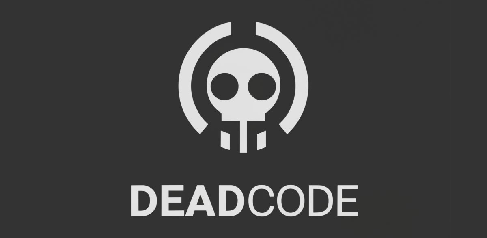

[](https://deadcode.readthedocs.io/)

<h2 align="center">Find and Fix Unused Python Code</h2>

<p align="center">
<a href="https://github.com/pre-commit/pre-commit"></a>
<a href="https://pypi.org/project/deadcode/"></a>
<a href="https://pepy.tech/project/deadcode"></a>
<a href="https://github.com/albertas/deadcode/blob/main/LICENSE"></a>
<br/><a href='https://ko-fi.com/V7V21681GD' target='_blank'></a>
</p>


## Installation
```shell
pip install deadcode
```

## Usage
To see unused code findings:
```shell
deadcode .
```

To see suggested fixes for all files:
```shell
deadcode . --fix --dry
```

To see suggested fixes only for `foo.py` file:
```shell
deadcode . --fix --dry --only foo.py
```

To fix:
```shell
deadcode . --fix
```

Tune out some of the false positives, e.g.:
```
deadcode . --exclude=venv,tests --ignore-names=BaseTestCase,*Mixin --ignore-names-in-files=migrations
```

The same options can be provided in `pyproject.toml` settings file:
```
[tool.deadcode]
exclude = ["venv", "tests"]
ignore-names = ["BaseTestCase", "*Mixin"]
ignore-names-in-files = ["migrations"]
ignore-names-if-inherits-from = ["BaseModel", "*.ObjectType"]
```

## Using deadcode on a FastAPI project

FastAPI registers handlers through decorators and populates Pydantic model fields at runtime, so both look unused to a static analyser.
Configure deadcode like this:

```toml
[tool.deadcode]
ignore-names-if-decorated-with = ["@app.*", "@router.*"]
ignore-bodies-if-inherits-from = ["BaseModel"]
```

Read the [FastAPI guide](https://deadcode.readthedocs.io/en/latest/fastapi.html) for common use cases, the complete example application,
the dependency injection strategy, and the expected output with no wrong detections.

## Pre-commit hook
Create a `.pre-commit-config.yaml` file in the root of your project directory, if it doesn't exist, and add the following to the file:

```
# See https://pre-commit.com for more information
# See https://pre-commit.com/hooks.html for more hooks
repos:
  - repo: https://github.com/albertas/deadcode
    rev: 2.5.0
    hooks:
      - id: deadcode
```

The `rev` is the release tag, so it matches the version published on PyPI. To
run the same hook while developing deadcode itself, use `make pre-commit`.

## Command line options

| Option&nbsp;&nbsp;&nbsp;&nbsp;&nbsp;&nbsp;&nbsp;&nbsp;&nbsp;&nbsp;&nbsp;&nbsp;&nbsp;&nbsp;&nbsp;&nbsp;&nbsp;&nbsp;&nbsp;&nbsp;&nbsp;&nbsp;&nbsp;&nbsp;&nbsp;&nbsp;&nbsp;&nbsp;&nbsp;&nbsp;&nbsp;&nbsp;&nbsp;&nbsp;&nbsp; | Type | Meaning  |
|-------------------------------------------|------|----------------------------------------------------------------------|
|`--fix`                                    | -    | Automatically remove detected unused code expressions from the code base. |
|`--dry`                                    | -    | Show changes which would be made in files. |
|`--only`                                   | list | Filenames (or path expressions), that will be reflected in the output (and modified if needed). |
|`--exclude`                                | list | Filenames (or path expressions), which will be completely skipped without being analysed. |
|`--ignore-names`                           | list | Removes provided list of names from the output. Regexp expressions to match multiple names can also be provided, e.g. `*Mixin` will match all classes ending with `Mixin`. |
|`--ignore-names-in-files`                  | list | Ignores unused names in files, which filenames match provided path expressions. |
|`--ignore-names-if-inherits-from`          | list | Ignores names of classes which inherit from any of the provided class names. The class name may be a plain name, a dotted path such as `graphene.ObjectType`, or a glob such as `*.ObjectType`; a dotted base also matches its final component (`ObjectType`). Only the class name is suppressed; its members and body are controlled by `--ignore-bodies-if-inherits-from` and `--ignore-definitions-if-inherits-from`. |
|`--ignore-names-if-decorated-with`         | list | Ignores names of an expression, which is decorated with one of the provided decorator names. |
|`--ignore-bodies-of`                       | list | Ignores body of an expression if its name matches any of the provided names. |
|`--ignore-bodies-if-decorated-with`        | list | Ignores body of an expression if its decorated with one of the provided decorator names. |
|`--ignore-bodies-if-inherits-from`         | list | Ignores body of a class if it inherits from any of the provided class names. The class name may be a plain name, a dotted path such as `graphene.ObjectType`, or a glob such as `*.ObjectType`; a dotted base also matches its final component (`ObjectType`). |
|`--ignore-definitions`                     | list | Ignores definition (including name and body) if a name of an expression matches any of the provided ones. Applies to class, function, method and property definitions, not to variables, attributes or imports; use `--ignore-names` for those. |
|`--ignore-definitions-if-inherits-from`    | list | Ignores definition (including name and body) of a class if it inherits from any of the provided class names. The class name may be a plain name, a dotted path such as `graphene.ObjectType`, or a glob such as `*.ObjectType`; a dotted base also matches its final component (`ObjectType`). |
|`--ignore-definitions-if-decorated-with`   | list | Ignores definition (including name and body) of an expression, which is decorated with any of the provided decorator names. |
|`--no-color`                               | -    | Removes colors from the output. |
|`--count`                                  | -    | Provides the count of the detected unused names instead of printing them all out. |
|`--quiet`                                  | -    | Does not output anything. The command exits with code 1 if unused names are found. |
|`-V`, `--version`                          | -    | Shows `deadcode` version. |
|`-v`, `--verbose`                          | -    | Shows verbose logging output. |

### Decorator matching
Decorator names are written as in the source, including the leading `@`; a pattern without `@` matches nothing.
Entries are glob patterns matched with `fnmatch.fnmatchcase`, so `*`, `?` and `[seq]` apply and `*` also crosses dots
(`@app.*` matches `@app.route`). Matching is case-sensitive.
Decorator call arguments are ignored, so `@app.route("/")` is matched as `@app.route`.
Stacked decorators match when any one decorator matches.
These options cover classes, functions, async functions, methods and properties; variables, attributes and imports are not covered.
Imports and aliases are not resolved, so `@aliased.route` needs `@aliased.*` rather than `@app.*`.
The same rules apply to all three decorated-with options.

```toml
[tool.deadcode]
ignore-names-if-decorated-with = ["@app.route"]
```

```python
@app.route("/", methods=["POST"])
def post_tax_adder_customer():
    pass
```

### Exit status

- `0` — no dead code found.
- `1` — dead code found (in any output mode).
- `2` — invalid command line usage.
- Unexpected errors print a Python traceback and exit `1`.

The status is independent of `--quiet`, `--count`, `--only`, `--dry`, and `--fix`.
A `--fix` run exits `1` on the run that found items and `0` on a subsequent run
over the cleaned tree.


##### Glossory
- `name` - variable, function or class name.
- `body` - code block which follows after `:` in function or class definition. A body ignore suppresses every definition inside the expression, including nested classes and functions.
- `definition` - whole class or function definition expression including its name and body.


## Rules
| Code   | Name               | Message        |
|--------|--------------------|----------------|
| DC01  | unused-variable      | Variable `{name}` is never used
| DC02  | unused-function      | Function `{name}` is never used
| DC03  | unused-class         | Class `{name}` is never used
| DC04  | unused-method        | Method `{name}` is never used
| DC05  | unused-attribute     | Attribute `{name}` is never used
| DC06  | unused-name          | Name `{name}` is never used
| DC07  | unused-import        | Import `{name}` is never used
| DC08  | unused-property      | Property `{name}` is never used
| DC09  | unreachable-if-block | Unreachable conditional statement block
| DC11  | empty-file           | Empty Python file
| DC12  | commented-out-code   | Commented out code
| DC13  | unreachable-code     | Code after terminal statement, e.g. `return`, `raise`, `continue`, `break`
| DC    | ignore-expression    | Do not show any findings for an expression, which starts on current line (this code can only be used in `# noqa: DC` comments)

## Ignoring checks with noqa comments
Inline `# noqa` comments can be used to ignore `deadcode` checks.
E.g. unused `Foo` class wont be detected/fixed because `# noqa: DC03` comment is used:

```python
class Foo:  # noqa: DC03
    pass
```

For a decorated function, method, property, or class, place the comment on the physical line of the `def`, `async def`, or `class` keyword:

```python
@cache
def foo():  # noqa: DC02
    pass
```

A comment on the first decorator line is still accepted.

## Ignoring unittest lifecycle methods
`unittest` lifecycle methods (`setUp`, `tearDown`, `setUpClass`, `tearDownClass`, `asyncSetUp`, `asyncTearDown`, `setUpModule`, `tearDownModule`) declared in test files are ignored by default, alongside the existing pytest hooks.
Declarations with those names outside test files are still reported as unused code.

## Contributing

Create a feature branch from `main`, open a pull request targeting `main`, and
wait for review. Do not commit feature changes directly to `main`; release
commits are made by the maintainer on `main`.

- `make check` - runs unit tests and other checks using virtual environment.
- `make test` - runs the test suite in parallel with `pytest-xdist`, using one worker per logical CPU minus one.
  Set `PYTEST_XDIST_WORKERS` to change the worker count (`make test PYTEST_XDIST_WORKERS=2`), or pass
  `PYTEST_ME_PLEASE="-n 0"` to run serially.

## Code coverage
Measured on revision `043f3f0` on 2026-11-08 with `make coverage-report` on CPython 3.10.22:

- Full suite (`--cov=.`): `94.61%`, that is 2844 covered of 3006 statements.
- Package only (`--include='deadcode/*'`): `94.81%`, that is 1187 covered of 1252 statements.

`pyproject.toml` configures `--cov-fail-under=88.0`, and that `88.0%` threshold applies to the full-suite `--cov=.` total that `make test` enforces.

The two scopes measure different things. `--cov=.` also measures the test code under `tests/` (1754 of the 3006 statements), so it is the number CI enforces,
while `--include='deadcode/*'` covers only the shipped `deadcode` package and is the API/package figure. Both are line coverage: `branch = False` is in effect,
so branch coverage is not measured.

A statistical confidence interval does not apply here. Coverage is a census of the statements in one fixed code revision, not a sample from a population, so
there is no sampling error to put an interval around. What does vary is the interpreter running the suite. `make coverage-matrix` measures every available
environment and reported a full-suite range of `94.60%` to `94.61%` and a package-only range of `94.78%` to `94.81%` across CPython 3.10.22, 3.11.17, 3.14.8,
and 3.15.0. Only interpreter-conditional import lines differ, which keeps the variation small:
`deadcode/actions/parse_arguments.py:6-9` imports `tomllib` on 3.11+ and `tomli` on 3.10, and `deadcode/__init__.py:1-8` falls back from
`importlib.metadata` to `importlib_metadata`.

That range is a measurement of this checkout, not a guarantee for future revisions, and coverage moves with every source or test change. Rerun the commands
below and trust their current output over the numbers recorded above.

- `make coverage-report` - runs the suite in `.venv` with the configured pytest options and prints the full-suite total, the package-only total, and the
  package-only per-module table.
- `make coverage-matrix` - runs the same measurement in every environment matched by `COVERAGE_ENVIRONMENTS` (default `.venv .venv3*`) and prints the
  interpreter version plus both totals per environment. Set it to choose environments, e.g.
  `make coverage-matrix COVERAGE_ENVIRONMENTS=".venv .venv311"`.
- `.venv/bin/python -m coverage report --include='deadcode/*'` - prints the package-only per-module table for the last run.
- `.venv/bin/python -m coverage report --format=total --precision=2` - prints the full-suite total for the last run; add `--include='deadcode/*'` for the
  package-only total.

## Rationale
[ruff](https://pypi.org/project/ruff/) and
[flake8](https://pypi.org/project/flake8/) - don't have rules for unused global
code detection, only for local ones `F823`, `F841`, `F842`. `deadcode` package
tries to add new `DCXXX` checks for detecting variables/functions/classes/files
which are not used in a whole code base.

`deadcode` - is supposed to be used inline with other static code checkers like `ruff`.

There is an alternative [vulture](https://pypi.org/project/vulture/) package.

## Known limitations
In case there are several definitions using the same name - they all wont be
reported if at least one usage of that name is being detected.

Files with syntax errors will be ignored, because `deadcode` uses `ast` to
build abstract syntax tree for name usage detection.

It is assumed that `deadcode` will be run using the same or higher Python version as the
code base is implemented in.

Wildcard imports are resolved by module basename, without package paths, so modules with the same basename are treated as one.
`__all__` is honoured only when it is a statically readable module-level list or tuple of strings; modules with unknown exports
(dynamic `__all__`, unreadable or unparsable files, or modules outside the analysed file set) are not restricted. Without `__all__`,
the public module-level names are exported.

## Feature requests
A checked entry is implemented on `main` and is included in the next release; published releases may lag behind `main`.

- [x] Replace `.*` with only `*` in regexp matching.
- [x] Add unused class method detection DC04 check.
- [x] Add `--fix` option to automatically remove detected dead code occourencies
- [x] Add a check for empty python files.
- [x] Split error codes into DC01, DC02, DC03 for variables, functions, class.
    - [x] Should have different codes for ignoring name and ignoring whole definition (reserved DCxx0 - ignore name, DCxx1 - ignore definition).
    - [ ] Allow to disable each check separately using:
        - [ ] inline comment.
        - [ ] pyproject.toml file
- [ ] Add a check for code in comments.
- [ ] Add target python version option, if specified it will be used for code base check.
- [ ] Add a `--depth` parameter to ignore nested code.. (To only check global scope use 0).
- [ ] Add options:
    - [x] --ignore-definitions
    - [x] --ignore-definitions-if-inherits-from
    - [x] --ignore-definitions-if-decorated-with
    - [x] --ignore-names-if-inherits-from
    - [x] --ignore-names-if-decorated-with
    - [x] --ignore-bodies-of
    - [x] --ignore-bodies-if-decorated-with
    - [x] --ignore-bodies-if-inherits-from
        - Question: would it be possible to ignore only certain types of checks for a body, e.g. only variable attributes of TypedDict and still check usage of methods and properties?
        - What expression would allow this type of precission?
- [ ] Distinguish between definitions with same name, but different files.
- [ ] Repeated application of `deadcode` till the output stops changing.
- [ ] Unreachable code detection and fixing: this should only be scoped for if statements and only limited to primitive variables.
- [ ] Benchmarking performance with larger projects (time, CPU and memory consumption) in order to optimize.
- [ ] `--fix` could accept a list of filenames as well (only those files would be changed, but the summary could would be full).
    (This might be confusing, because filenames, which have to be considered are provided without any flag, --fix is expected to not accept arguments)
- [ ] pre-commit-hook.
- [ ] language server.
- [ ] DC10: remove code after terminal statements like `raise`, `return`, `break`, `continue` and comes in the same scope.
- [ ] Add `ignore` and `per-file-ignores` command line and pyproject.toml options, which allows to skip some rules.
- [ ] Make sure that all rules are being skipped by `noqa` comment and all rules react to `noqa: rule_id` comments.
- [ ] Include package names into code item scope (dot-separated path), e.g. "package1.package2.module.class.method.variable".
- [ ] All options should be able to accept dot-separated path or a generic name, e.g. "marshmallow.Schema" vs "Schema",
  documentation should cleary demonstrate the behaviour/example that "Schema" means "*.Schema".
- [ ] Redefinition of an existing name makes previous name unreachable, unless it is assigned somehow.
- [ ] Check if file is still valid/parsable after automatic fixing, if not: halt the change and report error.
- [ ] Investigate ways of extracting and backporting Python3.10+ `ast` implementation to lower Python versions.

## Release notes
- next:
    - Features:
        - Add support for Python 3.13, 3.14 and 3.15.
        - Documentation is now published on Read the Docs at https://deadcode.readthedocs.io/.
        - Add `-V` as a short alias for `--version`.
        - `--ignore-definitions-if-decorated-with` now ignores whole decorated definitions
        - `--ignore-bodies-of` now suppresses the bodies of matching classes and functions
        - `--ignore-bodies-if-decorated-with` now suppresses the bodies of decorated definitions
        - `--ignore-names-if-inherits-from` now ignores class names matching a base class
        - `--ignore-definitions` now reliably ignores function, method, property and nested class definitions; its limits are documented
        - Add make targets to measure code coverage reproducibly
    - Bugfixes:
        - Exit with code 1 when unused code is found, so CI jobs and pre-commit hooks can fail.
        - Fix `--fix` leaving invalid or partially removed imports when unused names are deleted from parenthesized or multi-line import statements.
        - Fix `--fix` leaving invalid or fragmented imports when removing names from backslash-continued, semicolon-separated, or commented import statements.
        - Fix `--fix` leaving the continuation lines of multi-line unused assignments behind and producing invalid Python (issue #26).
        - Do not crash when the terminal cannot encode CLI output, including the success message, warnings and verbose logs.
        - Fix `deadcode --fix` removing the `f` from the `from` keyword in multi-line parenthesized imports (issue #5)
        - Remove fully unused import statements, including multi-line parenthesized ones, without leaving broken syntax behind
        - Remove only the unused names from partially used import statements while keeping the used names and their order
        - Honor `# noqa` comments on the definition line of decorated functions, methods and classes.
        - Wildcard imports now honour a module `__all__` list or tuple, so excluded names are reported as unused. Wildcard imports stay unrestricted when `__all__` is dynamic or unknown, and explicit imports keep working. Without `__all__`, wildcard imports expose public module-level names.
        - Honour `--ignore-names-if-decorated-with` for dotted decorators such as `@app.route`, so route handlers are not reported as unused (issue #30).
        - Decorator names are reported as dotted identifiers such as `@app.get` instead of memory addresses
        - `--ignore-names-if-decorated-with` now suppresses decorated functions, methods, properties, and classes
        - Print verbose log messages as readable ASCII instead of a `bytes` repr when the output stream cannot encode a character.
        - `--ignore-bodies-if-inherits-from` and `--ignore-definitions-if-inherits-from` now recognize dotted base classes such as `graphene.ObjectType` and match their final component.
        - Render decorator names deterministically, including dotted names, and stop unusual decorators such as `@Class().function()` from crashing or producing memory addresses.
        - Stop reporting unittest lifecycle methods declared in test files as unused code (issue #21).
        - Use pytest instead of unittest.TestCase
        - Fix `ignore-names-if-inherits-from` having no effect when set in `pyproject.toml`; its accepted base-class forms and class-name-only scope are now documented (issue #25)
        - A scalar string in `pyproject.toml` is now honoured as one pattern instead of being split into characters
- v2.5.0 (2026-11-07):
    - Bugfixes:
        - Fix a crash when a decorator has no `id` attribute.
- v2.4.1 (2024-08-09):
    - Features:
        - Add `--version` option to show `deadcode` version.
    - Bugfixes:
        - Use stdout for `deadcode` output.
- v2.4.0 (2024-07-12):
    - Features:
        - Add `--only` option that accepts filenames only which will be reflected in the output and modified.
          This option can be used with `--fix` and `--fix --dry` options as well as for simple unused code detection without fixing.
- v2.3.2 (2024-07-10):
    - Features:
        - Add `pre-commit` hook support.
        - Drop support for Python 3.8 and 3.9 versions, since their `ast` implementation is lacking features.
- v2.3.1 (2024-07-03):
    - Bugfixes:
        - Started analysing files in bytes instead of trying to convert them into UTF-8 encoded strings.
        - Improved automatic removal of unused imports.
- v2.3.0 (2024-04-07):
    - Features:
        - Add `--dry` option.
        - Update error codes to use DCXX format instead of DCXXX.
